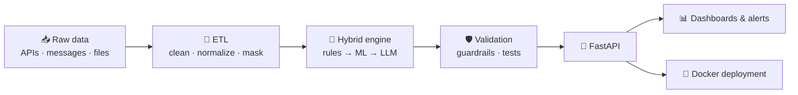

<!-- Bannière -->

  <h1>Mariyame Tazi</h1>

  

    

  
  
  
  

---

## 🧠 About Me

Data & AI Engineer with a **Master's in Artificial Intelligence and Connected Objects**. I design **reliable data pipelines** and **LLM-powered agents** and take them all the way to production.

During my final-year internship I shipped two systems:

- **A hybrid classification pipeline** processing ~47,000 multilingual messages (rules → ML → LLM), ~97% accuracy on an annotated validation set, with an API, dashboards and automated tests.
- **A WhatsApp AI agent** with 46 tools (function calling) that handles real bookings and payments, protected by anti-hallucination guardrails.

I enjoy turning messy data into systems people can trust through:

<table align="center">
  <tr>
    <td align="center" width="170">🧱 <b>Data Pipelines</b> ETL / ELT, quality checks, automation</td>
    <td align="center" width="170">🏛️ <b>Data Lakehouse</b> Medallion architecture, Delta Lake</td>
    <td align="center" width="170">🤖 <b>LLM Agents</b> Function calling, guardrails</td>
    <td align="center" width="170">🗣️ <b>Applied NLP</b> Multilingual Darija / FR / EN</td>
    <td align="center" width="170">📊 <b>Analytics & BI</b> KPIs, dashboards, alerts</td>
  </tr>
</table>

---

## 🛠️ Tech Stack

  

  
  
  
  
  
  
  

---

## 🧭 Where I Like to Work

<table>
  <tr>
    <td width="50%" valign="top">
      <h3>🧱 Data Engineering</h3>
      <i>"Make data trustworthy before anyone uses it."</i>
      <ul>
        <li>ETL / ELT pipelines and scheduling</li>
        <li>Lakehouse with Medallion layers</li>
        <li>Data quality checks and automated tests</li>
      </ul>
      
      
    </td>
    <td width="50%" valign="top">
      <h3>🤖 Agentic AI</h3>
      <i>"An agent is only useful if you can trust its actions."</i>
      <ul>
        <li>Function calling and tool orchestration</li>
        <li>Guardrails against hallucination</li>
        <li>Deploying and monitoring LLMs in production</li>
      </ul>
      
      
    </td>
  </tr>
  <tr>
    <td width="50%" valign="top">
      <h3>🗣️ Applied ML & NLP</h3>
      <i>"Models should work on the data people actually have."</i>
      <ul>
        <li>Multilingual NLP (Darija / French / English)</li>
        <li>Computer vision and tracking</li>
        <li>Recommendation and classification systems</li>
      </ul>
      
      
    </td>
    <td width="50%" valign="top">
      <h3>📊 Analytics & BI</h3>
      <i>"Insights only matter if someone can act on them."</i>
      <ul>
        <li>KPI dashboards for business teams</li>
        <li>Alerting and trend / anomaly tracking</li>
        <li>Decision support reporting</li>
      </ul>
      
      
    </td>
  </tr>
</table>

---

## ⚙️ How I Build

---

## 🎯 Current Focus

| Goal | Status |
|---|---|
| Publish the **E-commerce Lakehouse** (Databricks · PySpark · Delta Lake) | 🔨 In progress |
| Publish a demo of an **LLM booking agent** (synthetic data, no secrets) | 📝 Planned |
| Orchestrate pipelines with **Apache Airflow** and model with **dbt** | 🌱 Learning |
| Cloud data platforms (**AWS / Azure**) and certification | 🌱 Learning |
| Land my **first Data Engineer / AI Engineer role** | 🎯 Active search |

---

## 📫 Let's Connect

  
  

